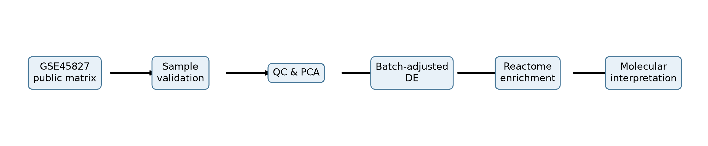
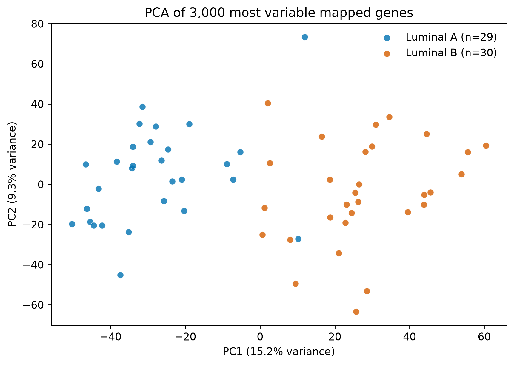
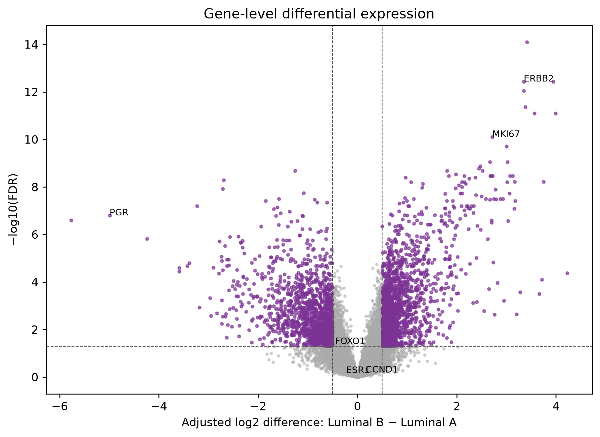
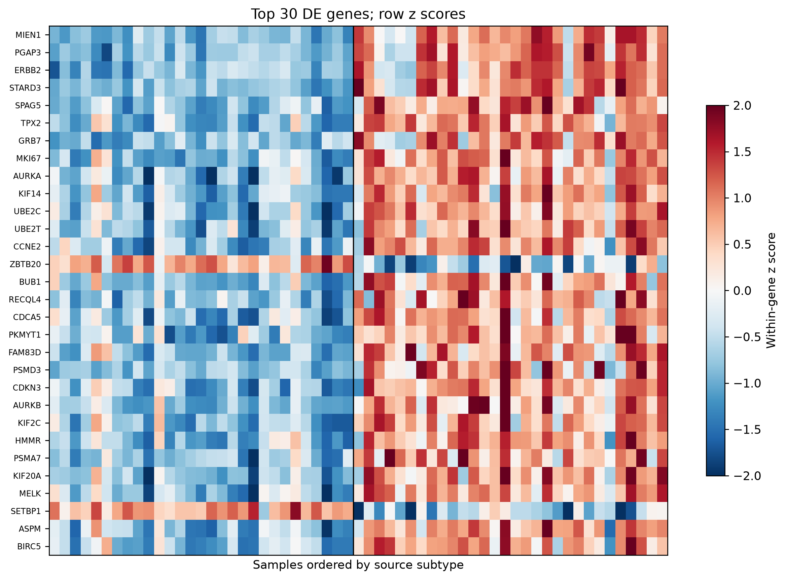
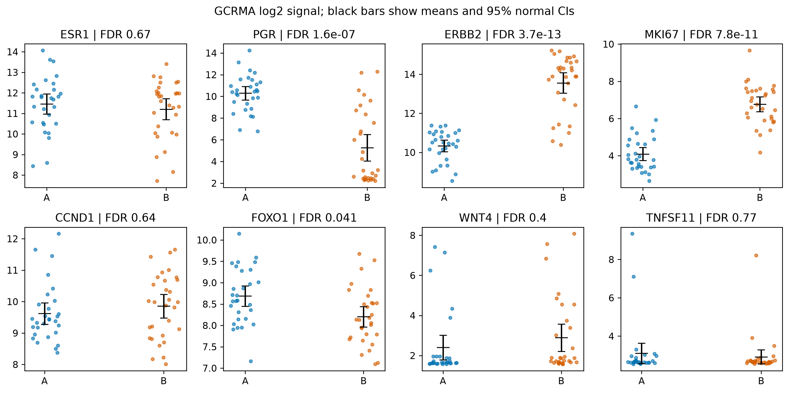
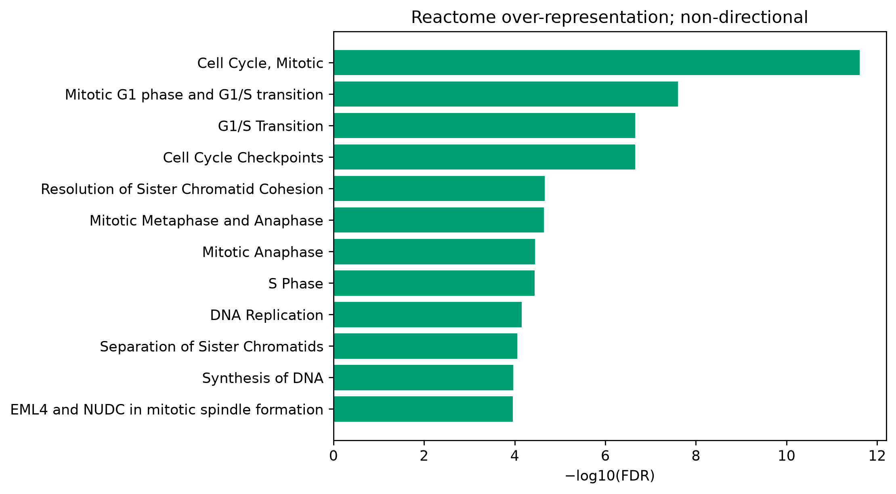
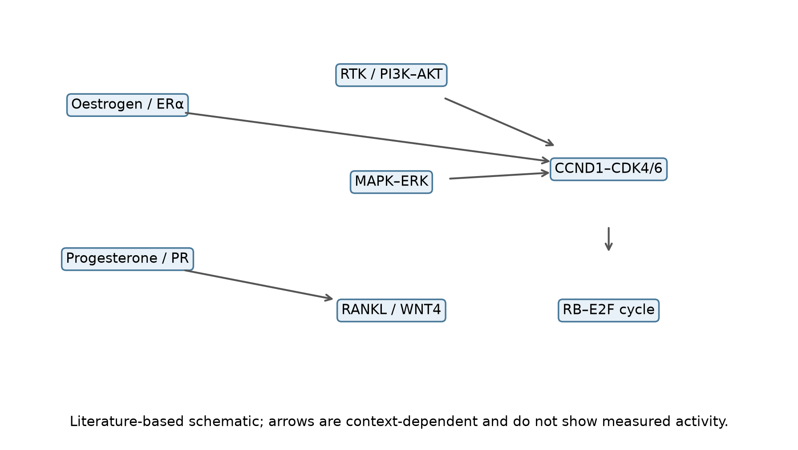
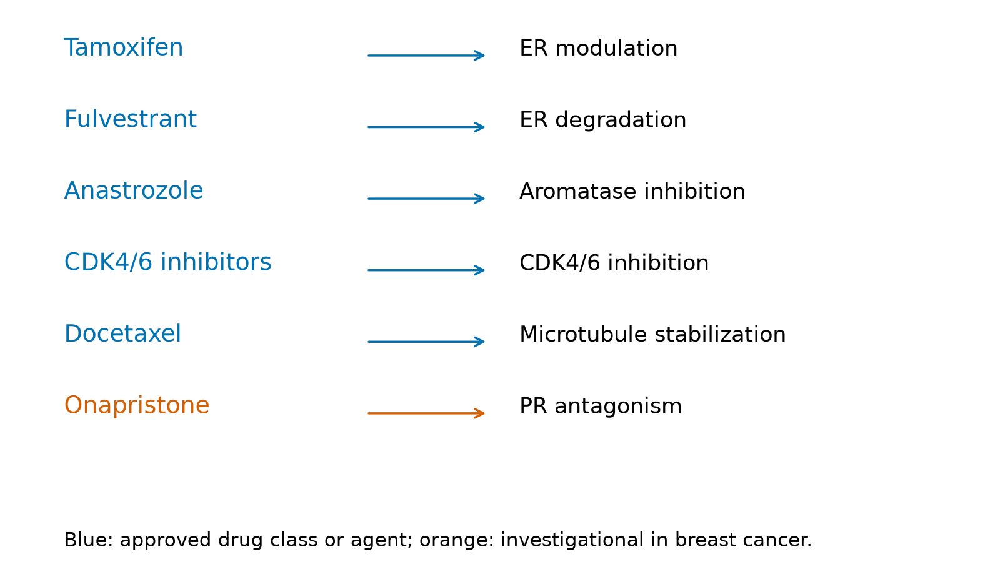

# Molecular and Transcriptomic Analysis of Hormone Receptor-Positive Breast Cancer

**Tharuniya Anpalakan** · Reproducible secondary analysis · 16 October 2026

## Project overview

Hormone receptor-positive breast cancer contains biologically diverse tumours. This project asks how transcriptomic patterns differ between two **source-labelled luminal groups** and how those differences relate to endocrine and cell-cycle biology. It combines a biomedical science foundation in ER/PR signalling with an executable microarray analysis. It is a computational research portfolio project, not a clinical test or a new wet-lab study.

## Research motivation and scientific background

ERα (encoded by *ESR1*) and PR (encoded by *PGR*) shape transcriptional responses to steroid hormones. Their networks interact with growth-factor, PI3K/AKT, MAPK and CCND1–CDK4/6–RB–E2F programmes. Tumours assigned Luminal A and Luminal B labels can therefore differ in proliferation and endocrine-associated transcripts. Intrinsic expression subtypes and IHC receptor categories are related but not interchangeable ([Parker et al., 2009](https://doi.org/10.1200/JCO.2008.18.1370); [Mohammed et al., 2015](https://doi.org/10.1038/nature14583)). See [molecular background](docs/molecular_background.md) for pathways, therapies and resistance.

## Research objectives

1. Validate source subtype labels and batches in a real public expression matrix.
2. Compare labelled Luminal B and Luminal A tumours with a batch-adjusted model.
3. Examine ER/PR, proliferation and signalling genes, then test Reactome pathway over-representation.
4. Separate observed transcriptional associations from established mechanisms and clinical claims.

## Dataset

GEO [GSE45827](https://www.ncbi.nlm.nih.gov/geo/query/acc.cgi?acc=GSE45827) contains Affymetrix GPL570 microarrays from 130 primary invasive tumours, 11 normal tissues and 14 cell lines. This analysis retains **29 Luminal A** and **30 Luminal B** tumour columns according to GEO `tumor subtype` metadata. Other columns are excluded. The depositing laboratory reports GC-RMA normalized log2 intensities and batch metadata. Individual ER/PR IHC results and independent PAM50 calls are not supplied in the selected matrix. This is a secondary question to the [original Gruosso et al. (2016) study](https://doi.org/10.15252/emmm.201505891). See [dataset selection](docs/dataset_selection.md) and [provenance](docs/data_provenance.md).

## Computational methodology

The pipeline validates sample IDs and expected counts, uses the GPL570 annotation to retain one unambiguous probe per gene, inspects intensity distributions and PCA, and fits a linear model with subtype and batch indicators. A limma-style empirical-Bayes variance moderation is implemented in Python; it has **not** been formally cross-validated against Bioconductor limma. Benjamini–Hochberg correction controls the reported gene-level FDR. Reactome release 97 over-representation uses tested genes as the universe and genes with FDR <0.05 and absolute log2 difference ≥0.5 as the foreground. See [methods](docs/methodology.md).

## Results and key findings

| Measure | Executed result |
|---|---:|
| Eligible tumours | 59 (29 A, 30 B) |
| Genes tested | 13,823 |
| Genes at FDR <0.05 | 4,310 |
| Genes at FDR <0.05 and abs(log2 difference) ≥0.5 | 2,775 |
| Reactome sets tested / FDR <0.05 | 1,568 / 75 |
| PCA variance, PC1 / PC2 | 15.2% / 9.3% |

Log2 differences are **Luminal B minus Luminal A**, after batch adjustment.

| Gene | Log2 difference | FDR | Interpretation of this dataset |
|---|---:|---:|---|
| *PGR* | −4.993 | 1.57×10⁻⁷ | Lower PR transcript signal in labelled B |
| *MKI67* | +2.716 | 7.82×10⁻¹¹ | Higher proliferation-marker transcript |
| *ERBB2* | +3.350 | 3.65×10⁻¹³ | Higher HER2 transcript; receptor protein status unavailable |
| *ESR1* | −0.228 | 0.673 | No evidence of a difference at this threshold |
| *CCND1* | +0.165 | 0.640 | No evidence of a difference at this threshold |
| *WNT4* | +0.548 | 0.404 | No evidence of a difference at this threshold |

The most enriched Reactome category was **Cell Cycle, Mitotic** (164 overlapping genes; FDR 2.41×10⁻¹²), followed by G1/S and checkpoint sets. This non-directional enrichment is consistent with broad cell-cycle transcriptional differences; it does not prove pathway activation. Full data are in [differential expression](results/differential_expression.csv), [marker summary](results/marker_summary.csv), [pathway enrichment](results/pathway_enrichment.csv) and [summary](results/summary.json). Each candidate marker is discussed in [marker interpretation](docs/marker_interpretation.md).

## Molecular interpretation

The higher *MKI67* signal and cell-cycle enrichment fit the source labels' expected proliferation contrast. Lower *PGR* is compatible with an altered ER/PR programme; higher *ERBB2* may reflect biological heterogeneity in the labelled Luminal B samples. These are **associations in one microarray cohort**. *ESR1* mRNA did not differ significantly, and neither mRNA levels nor pathway membership establish ER protein activity, mutation status, treatment response or prognosis. See [interpretation notebook](notebooks/06_results_interpretation.ipynb) and [limitations](docs/limitations.md).

## Scientific visualizations

| Figure | Description |
|---|---|
|  | Study workflow; conceptual |
|  | PCA of observed normalized signals |
|  | Batch-adjusted gene differences and FDR |
|  | Top 30 differential genes, row z scores |
|  | Observed marker signals with means and approximate 95% CIs |
|  | Non-directional Reactome over-representation |
|  | Literature-based, context-dependent relationships |
|  | Drug targets; onapristone marked investigational |

The figures are also saved as SVG. Figure 1, 7 and 8 contain no experimental measurements. Captions and analytical limits are in the [report](reports/molecular_transcriptomic_analysis.pdf).

## Therapeutic implications

Tamoxifen, fulvestrant, aromatase inhibitors and selected CDK4/6 inhibitors have established breast-cancer indications; docetaxel acts through microtubules. Onapristone remains investigational for this context ([NCI drug list](https://www.cancer.gov/about-cancer/treatment/drugs/breast); [Cottu et al., 2018](https://doi.org/10.1371/journal.pone.0204973)). This transcriptomic comparison supplies no individual treatment recommendation or resistance test.

## Research limitations

Source labels are not independently validated by IHC or PAM50 here. Clinical covariates, tumour purity, outcome and treatment history are unavailable. Probe mapping is based on a dated annotation. The model is an independent limma-style implementation requiring cross-validation against limma. This is one cohort without external validation. The complete limitations are [documented here](docs/limitations.md).

## Reproducibility

Use Python 3.11 or later from the repository root:

```bash
python -m venv .venv
# Windows PowerShell: .\.venv\Scripts\Activate.ps1
# macOS/Linux: source .venv/bin/activate
python -m pip install -r requirements.txt
python -m scripts.download_data
```

The download script retrieves the [official Reactome release 97 GMT](https://www.reactome.org/download/current/ReactomePathways.gmt.zip) and verifies all three input SHA-256 values, including extracted GMT checksum `89983d5c1f0af11c52edfeee7323eb425580ac6281d387a528562ab1787ce56b`; see [provenance](docs/data_provenance.md). Then run:

```bash
python -m scripts.run_analysis
python -m scripts.build_report
python -m scripts.run_notebooks
python -m pytest -q
```

The notebook command executes notebooks 01–06 in order from the repository root after the pipeline has generated its outputs. They use functions in `src/` and the pipeline outputs. `data/raw/` and `data/processed/` are ignored by Git. Input hashes are recorded in `results/summary.json`. The private historical source documents are also ignored.

## Detailed LaTeX report

The [detailed research report](reports/molecular_transcriptomic_analysis.pdf) is typeset from [editable LaTeX source](reports/molecular_transcriptomic_analysis.tex), with expanded methods, equations, marker and pathway tables, eight figures, references and reproducibility appendices. Download the [complete LaTeX source ZIP](reports/latex_source.zip) for Overleaf, or see the [build instructions](reports/LATEX_README.md). `python -m scripts.build_report` requires XeLaTeX (MiKTeX or TeX Live) and generates an upload-ready `reports/latex_source.zip`. The older `.qmd` is retained as the earlier short narrative.

## Project structure

`src/` holds reusable analysis and plotting code; `scripts/` holds entry points; `data/metadata/` holds public sample classifications; `results/` and `figures/` hold executed outputs; `notebooks/` provides an inspectable narrative; `reports/` contains the editable report and PDF; `docs/` records source decisions, methods and audit; `references/` contains verified bibliography entries.

## References

Key sources: [GSE45827 / Gruosso et al. (2016)](https://doi.org/10.15252/emmm.201505891); [Parker et al. (2009)](https://doi.org/10.1200/JCO.2008.18.1370); [Mohammed et al. (2015)](https://doi.org/10.1038/nature14583); [Smyth (2004)](https://doi.org/10.2202/1544-6115.1027); [Ritchie et al. (2015)](https://doi.org/10.1093/nar/gkv007); [Reactome downloads](https://reactome.org/download-data). See [bibliography](references/bibliography.bib) and [background](docs/molecular_background.md).

## Author and contribution note

**Tharuniya Anpalakan** is the named portfolio author. The earlier risk-factor presentation was group work and is not represented here as solely hers. AI assistance was used for code and prose drafting; scientific claims, results and release decisions require author review. No affiliation, qualification, new patient experiment or peer-reviewed publication is claimed.
